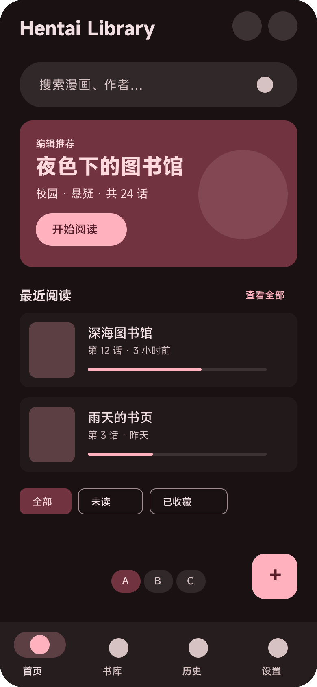
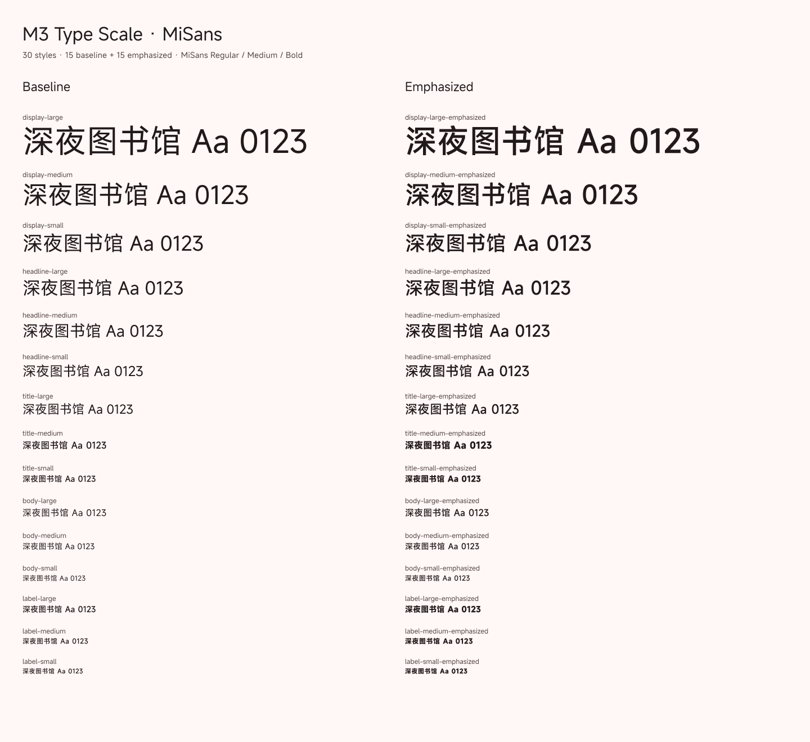
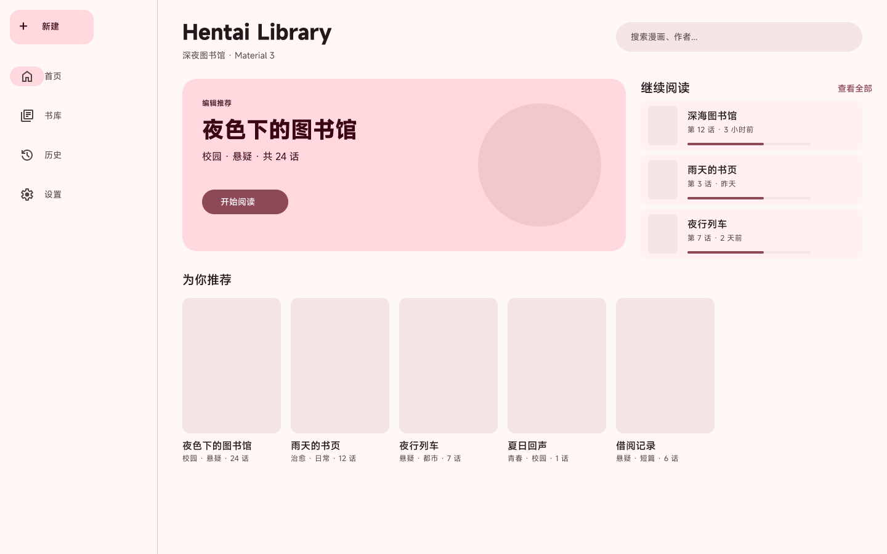
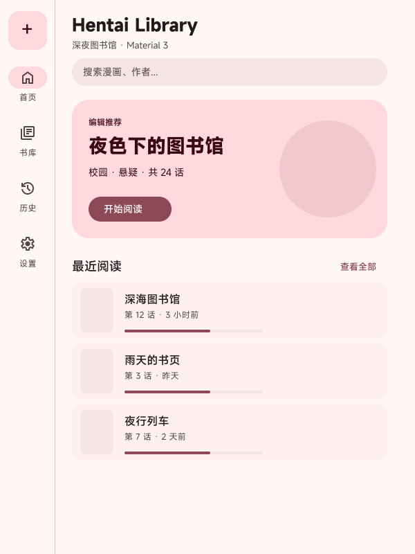
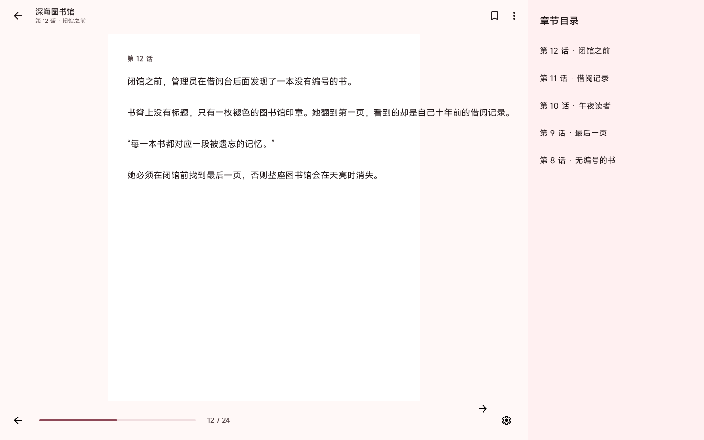
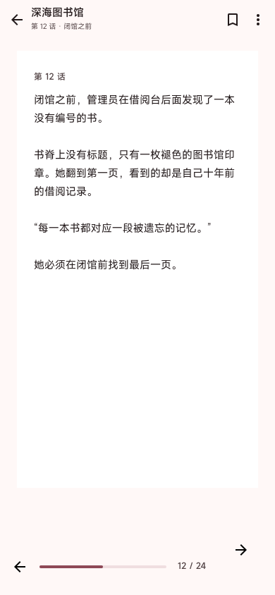
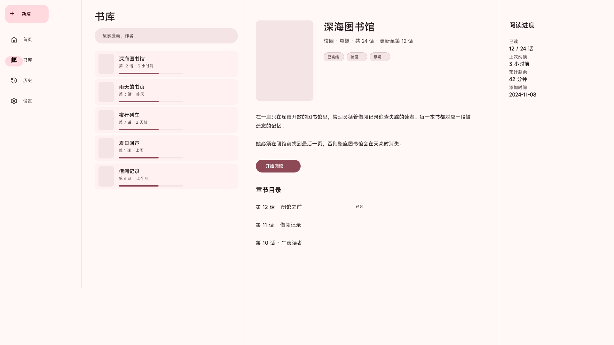

# Hentai Library · Material 3 设计系统（MASTER）

> 状态：**Figma 设计稿阶段完成，待评审**。本文件是设计系统的唯一规划入口；颜色方向 A 已定（亮/暗预览）、44 个 Number token、30 个 Text Style、6 个 Effect Style、5 个 Grid Style、01–04 文档页已建；05 已建齐 P0 原子组件集（补 SearchBar / TopAppBar / Snackbar），06 有 8 个业务组件，07 五档模板齐全，08 首页与阅读器四档出图、Settings 与 History 各两档，09 States & Content Lab、10 Motion、11 Handoff & A11y 已建成。代码未迁移。
> 代码未迁移：`app/` 仍是旧 Fluent 取向的主题与页面。设计稿评审通过后才改代码（见 §8）。
> 证据底稿：`design-system/research/material-design-3/`（01 基础、02 组件、03 Flutter 实现、04 Figma 工作流、05 粉色方向、06 自适应布局）。规范数值若与本文件冲突，先查底稿的证据级别（A 官方规范 / B 官方实现源码 / C 推断）。

## Directory charter

`design-system/` 的职责边界（ADR-0029 修订后仍适用）：

| 路径 | 角色 | 是否规范来源 |
|---|---|---|
| `design-system/hentai-library/MASTER.md` | 设计系统总纲：决策、token、组件清单、Figma 页面图、代码映射 | **是**（语义与用法） |
| `design-system/hentai-library/pages/*.md` | 每条路由的版式与状态说明（待重建） | 是（页面级） |
| `design-system/research/material-design-3/*` | 一手来源调研、取色记录、Figma API 经验 | 否（证据底稿） |
| `app/lib/shared/ui/theme/` | 颜色的**数值真源**；`buildAppTheme` 是唯一装配入口 | 是（数值） |
| `app/lib/shared/ui/layout/` | 断点与壳层布局的代码实现 | 是（布局数值） |

规则：

1. **数值真源在代码**（`theme/`），语义与用法真源在本文件；Figma 是设计与代码之间的镜像，不反过来定义 token 名。
2. 调研目录只回答「官方怎么说」，不作为交付规范；把结论提炼进本文件时必须保留证据级别。
3. `pages/` 不进 Figma 组件库；Screens 页只放带真实内容的实例。
4. 本文件不复制 Figma 变量表之外的派生值；颜色/字阶以 §2/§3 为准。

## 1. 已锁定决策

| # | 决策 | 结论 | 说明 |
|---|---|---|---|
| D1 | 断点 | **M3 五档 600 / 840 / 1200 / 1600** | 设计稿按五档出；代码 `app_layout_breakpoints.dart` 仍是 600/1024，迁移时改 |
| D2 | 字体 | **MiSans**，Regular / Medium / Semibold / Bold | Figma 字族 `MiSans`；style `Semibold` 无空格。应用目前只打包 Regular，迁移时补资产 |
| D3 | 品牌色 | **A · 柔和玫瑰**：`#E91E63` + `tonalSpot` | 46 角色见 §2；B/C 变量与预览移至 `12 Archive & Scratch` 作备选 |
| D4 | 状态反馈 | **恢复 M3 state layer；splash 按平台**：移动端开启，桌面端关闭 | hover 8% / focus 12% / pressed 12% / dragged 16%；桌面用 state layer 代替 splash。细节见 §4.4；代码暂不动 |
| D7 | 首批设计稿 | **主壳 + 首页 + 书库 + 阅读器** | 1440×900 主稿，1024×768 验接缝，600×800 验紧凑；按此顺序评审 |
| D8 | 图标集 | **Material Symbols** | outlined 为默认，selected/激活用 filled；`04 Icons & Assets` 按此建，代码迁移时替换 `lucide_icons_flutter` |
| D5 | Expressive | **排除**（按调研建议；用户未反对） | Flutter 无官方支持（flutter/flutter#168813 仍 Open）；官方 Figma kit 已 Expressive 化，因此自建库 |
| D6 | 建库方式 | **混合**：手工定结构 + figwright 批量写节点 | 结构、命名、页面分工手工决定；重复节点用脚本 |
| — | 交付顺序 | **先 Figma 设计稿，定稿后才改代码** | 用户明确要求；代码迁移不在本轮 |

D1–D8 已全部拍板；设计侧进入组件集与首批页面。代码仍按约定等设计稿定稿后再动。

## 2. 颜色

### 2.1 生成方式

- seed `#E91E63`，scheme variant `tonalSpot`（即 Flutter `ColorScheme.fromSeed` 默认），由 `material_color_utilities 0.11.1` 的 `MaterialDynamicColors` 生成。
- 46 个角色，命名 `color/<camelCaseRole>`；不含 3.22 起弃用的 `background` / `onBackground` / `surfaceVariant`。
- 生成脚本与原始输出：`.scratch/generate_palette.dart`、`.scratch/palette.json`（非交付物，临时文件）。
- Figma 是 Starter 套餐：每个 variable collection 只能 1 个 mode，所以按「一主题一 collection」建了 6 个集合（A/B/C × Light/Dark），每个 46 变量。

### 2.2 正式 token（A · 柔和玫瑰）

| role | Light | Dark | role | Light | Dark |
|---|---|---|---|---|---|
| primary | `#8E4957` | `#FFB2BE` | onPrimary | `#FFFFFF` | `#561D2A` |
| primaryContainer | `#FFD9DE` | `#71333F` | onPrimaryContainer | `#3B0716` | `#FFD9DE` |
| primaryFixed | `#FFD9DE` | `#FFD9DE` | primaryFixedDim | `#FFB2BE` | `#FFB2BE` |
| onPrimaryFixed | `#3B0716` | `#3B0716` | onPrimaryFixedVariant | `#71333F` | `#71333F` |
| secondary | `#75565B` | `#E5BDC2` | onSecondary | `#FFFFFF` | `#43292D` |
| secondaryContainer | `#FFD9DE` | `#5C3F43` | onSecondaryContainer | `#2C1519` | `#FFD9DE` |
| secondaryFixed | `#FFD9DE` | `#FFD9DE` | secondaryFixedDim | `#E5BDC2` | `#E5BDC2` |
| onSecondaryFixed | `#2C1519` | `#2C1519` | onSecondaryFixedVariant | `#5C3F43` | `#5C3F43` |
| tertiary | `#795831` | `#EBBF90` | onTertiary | `#FFFFFF` | `#452B08` |
| tertiaryContainer | `#FFDDBA` | `#5F411C` | onTertiaryContainer | `#2B1700` | `#FFDDBA` |
| tertiaryFixed | `#FFDDBA` | `#FFDDBA` | tertiaryFixedDim | `#EBBF90` | `#EBBF90` |
| onTertiaryFixed | `#2B1700` | `#2B1700` | onTertiaryFixedVariant | `#5F411C` | `#5F411C` |
| error | `#BA1A1A` | `#FFB4AB` | onError | `#FFFFFF` | `#690005` |
| errorContainer | `#FFDAD6` | `#93000A` | onErrorContainer | `#410002` | `#FFDAD6` |
| surface | `#FFF8F7` | `#191112` | onSurface | `#22191A` | `#F0DEE0` |
| surfaceDim | `#E7D6D7` | `#191112` | surfaceBright | `#FFF8F7` | `#413738` |
| surfaceContainerLowest | `#FFFFFF` | `#140C0D` | surfaceContainerLow | `#FFF0F1` | `#22191A` |
| surfaceContainer | `#FBEAEB` | `#261D1E` | surfaceContainerHigh | `#F5E4E5` | `#312829` |
| surfaceContainerHighest | `#F0DEE0` | `#3C3233` | onSurfaceVariant | `#524345` | `#D6C2C3` |
| outline | `#847375` | `#9F8C8E` | outlineVariant | `#D6C2C3` | `#524345` |
| inverseSurface | `#382E2F` | `#F0DEE0` | inverseOnSurface | `#FEEDEE` | `#382E2F` |
| inversePrimary | `#FFB2BE` | `#8E4957` | shadow | `#000000` | `#000000` |
| scrim | `#000000` | `#000000` | surfaceTint | `#8E4957` | `#FFB2BE` |

### 2.3 用法规则

- **primary**：主 CTA、选中态、进度、链接。A 的 primary 偏灰玫瑰，大面积铺底会显脏；大面积品牌区用 `primaryContainer`。
- **surface 家族**：页面底 `surface`；卡片/列表容器按层级用 `surfaceContainerLow` → `surfaceContainer` → `surfaceContainerHigh`；不要再拿 elevation 阴影表达层级。
- **on* 配对**：文字/图标放在同色容器上时用对应 `on*`；不要用纯黑/纯白绕过 token。
- **fixed 角色**：只用于跨主题保持不变的内容（品牌插画、固定徽标）；普通界面不用。
- **surfaceTint = primary**：tonal elevation 只在需要时叠加（0/1/3/6/8/12 → 0/0.05/0.08/0.11/0.12/0.14），默认不叠。

### 2.4 对比度（WCAG，计算值）

| 组合 | A-Light | A-Dark |
|---|---:|---:|
| primary / onPrimary | 6.48 | 7.70 |
| primaryContainer / onPrimaryContainer | 13.22 | 7.22 |
| surface / onSurface | 16.38 | 14.36 |
| surface / onSurfaceVariant | 8.91 | 10.94 |

### 2.5 Figma 落点

- 页面 `01 Tokens`（`9:9`）：6 个 collection `Theme/{A,B,C} · {Light,Dark}`（id 见 `05-color-directions.md` §2）。
- 方向预览：A `10:308`、B `10:357`、C `10:404`，390×844，靠原型 `粉色方案 A/B/C` 切换；A 为起点。
- 暗色预览：`A · 柔和玫瑰 · Dark Preview` `13:578`（y=1020），53 填充 + 2 描边绑定 `Theme/A · Dark`；切换器已隐藏、不参与原型。
- 预览只用于色彩评审，不是首页版式交付。

## 3. 排版

### 3.1 字阶（30 个 Text Style，已建）

字重代号：R=Regular 400，M=Medium 500，B=Bold 700。emphasized 与 baseline 同字号/行高，仅字重与少量 tracking 不同。

| token | size / line-height | tracking (base / emph) | baseline | emphasized |
|---|---:|---:|---|---|
| display-large | 57 / 64 | -0.25 / 0 | R | M |
| display-medium | 45 / 52 | 0 / 0 | R | M |
| display-small | 36 / 44 | 0 / 0 | R | M |
| headline-large | 32 / 40 | 0 / 0 | R | M |
| headline-medium | 28 / 36 | 0 / 0 | R | M |
| headline-small | 24 / 32 | 0 / 0 | R | M |
| title-large | 22 / 28 | 0 / 0 | R | M |
| title-medium | 16 / 24 | 0.15 / 0.15 | M | B |
| title-small | 14 / 20 | 0.1 / 0.1 | M | B |
| body-large | 16 / 24 | 0.5 / 0.15 | R | M |
| body-medium | 14 / 20 | 0.25 / 0.25 | R | M |
| body-small | 12 / 16 | 0.4 / 0.4 | R | M |
| label-large | 14 / 20 | 0.1 / 0.1 | M | B |
| label-medium | 12 / 16 | 0.5 / 0.5 | M | B |
| label-small | 11 / 16 | 0.5 / 0.5 | M | B |

- tracking 采用 material-web v0.192 值，与 Flutter `englishLike2021` 对齐；与 Compose tokens 有 3 处冲突（display-large、title-medium、body-medium），已选 web/Flutter 一侧。
- Figma 样式名与 token 同名（`display-large`、`display-large-emphasized`），无分组前缀，便于交接时直接搜 token。
- 样张 frame `10:577`（页面 `02 Styles`）：左 baseline / 右 emphasized，30 行全量对照。

### 3.2 字体映射

| Figma style | FontWeight（Flutter） | 用途 |
|---|---|---|
| Regular | `w400` | display/headline/title-large/body 的 baseline |
| Medium | `w500` | title-medium/small、全部 label、emphasized 的 display/headline/title-large/body |
| Bold | `w700` | emphasized 的 title/label |
| Semibold | `w600` | 当前 30 样式未使用；留给自定义强调（谨慎新增） |

- 应用侧 `app/pubspec.yaml` 目前只有 `assets/fonts/MiSans-Regular.ttf`，迁移时必须补 Medium/Bold 资产并注册 `fontWeight`，否则层级会塌。
- CJK 行高：M3 2026 起会按 script 调整；本项目先按表中固定行高，等官方 Flutter 实现再对齐。

## 4. 形状 / 高度 / 动效 / 数值 token

### 4.1 Number tokens（Figma collection `Number`）

| 组 | 值 | 用法 |
|---|---|---|
| spacing | 0 / 4 / 8 / 12 / 16 / 24 / 32 / 48 / 64 | 4/8 体系；M3 未规定 spacing scale，属项目决策 |
| radius | none 0 / xs 4 / sm 8 / md 12 / lg 16 / xl 28 / full 999 | 卡片 12、对话框 28、FAB 16、按钮与 chip = full |
| size | control 40 / touch 48 / list 56·72·88 / fab 56·80·96 / extended-fab 56 | 视觉高度可 40，触达不得小于 48 |
| state | hover 8% / focus 12% / pressed 12% / dragged 16% / disabled 38%·12% | 见 §4.4 |
| breakpoint | 600 / 840 / 1200 / 1600 | 见 §5 |
| icon | 20 / 24 / 40 | 默认 24 |
| elevation | 0 / 1 / 3 / 6 / 8 / 12 | 对应 level 0–5，见 §4.2 |

### 4.2 Elevation（Figma Effect Styles `elevation/level0–5`）

| level | dp | 阴影 | 表面角色 | 用途 |
|---|---:|---|---|---|
| 0 | 0 | 无 | surface | 静止背景 |
| 1 | 1 | 3 层 | surfaceContainerLow | 卡片 / hover |
| 2 | 3 | 3 层 | surfaceContainer | 菜单 / 拖拽 |
| 3 | 6 | 3 层 | surfaceContainerHigh | FAB / 对话框 |
| 4 | 8 | 3 层 | surfaceContainerHighest | hover 提升（仅交互中） |
| 5 | 12 | 3 层 | surfaceContainerHighest | dragged / 模态（仅交互中） |

- 阴影 dp 与 3 层黑色透明度（0.20 / 0.14 / 0.12）取自 Flutter `kElevationToShadow`（B 级官方实现）。
- **M3 的 elevation token 不含阴影**：高度主要靠 `surfaceContainer*` 色调表达；阴影是平台选择。桌面保留轻阴影，移动端可只留色调。
- Figma 中 Effect Style 只存阴影，色调必须在组件填充里绑对应 surface 角色。

### 4.3 Motion

| 场景 | 时长 | 曲线 |
|---|---:|---|
| enter（元素出现） | 400ms | Emphasized decelerate |
| exit（元素消失） | 200ms | Emphasized accelerate |
| 屏内状态变化 | 500ms | Emphasized |
| 通用过渡 | 300ms | Standard |
| 主曲线控制点 | — | 0.2, 0, 0, 1 |

- 桌面页面转场保留 fade-through（现有 `DesktopFadeThroughPageTransitionsBuilder`）。
- 所有位移/缩放必须受 reduce-motion 开关约束：开启时只保留淡入淡出。

### 4.4 状态反馈与 splash（D4 已定）

| 状态 | state layer 不透明度 | 说明 |
|---|---:|---|
| hover | 8% | 桌面指针悬停；移动端无 |
| focus | 12% | 键盘/焦点环之外的第二层反馈 |
| pressed | 12% | 按下瞬间；与 splash 二选一或叠加，避免双重变暗 |
| dragged | 16% | 拖拽/长按拖动 |

- **移动端（Android / iOS）**：保留平台默认 splash（ink ripple/sparkle）作为按压反馈；state layer 主要用于 selected/focus 等非瞬时态。
- **桌面端（Windows / macOS / Linux）**：关闭 splash（`NoSplash.splashFactory`），hover/pressed 全部由 state layer 提供；否则鼠标点击会出现与桌面习惯不符的扩散动画。
- 代码落点 `app/lib/shared/ui/theme/theme.dart:62-64`（现为 NoSplash + transparent highlight + `adaptivePlatformDensity`）；迁移时按 `Platform` 分支处理，并恢复 `visualDensity` 的触达最小值。
- 组件实现：`ButtonStyle.overlayColor` / `InkWell.hoverColor` / `MaterialStateProperty` 按上表取值；不要在组件里写死颜色，叠 `onSurface` 的 alpha。
- 触达尺寸：视觉高度可以 40，但可点击区不得小于 48×48（桌面与移动一致）。

## 5. 布局与断点

### 5.1 五档断点

| class | 宽度 (dp) | 代表 frame | 壳层 | 分栏 | 栅格 |
|---|---:|---|---|---|---|
| compact | < 600 | 390×844 | Navigation bar（高 80） | 1 | 4 列 / margin 16 / gutter 16 |
| medium | 600–839 | 800×1280 | Collapsed navigation rail（宽 80） | 1（推荐）或 2 | 8 列 / margin 24 / gutter 24 |
| expanded | 840–1199 | 1024×768 | Collapsed rail（可换 standard expanded） | 1 或 2（推荐 2） | 12 列 / margin 24 / gutter 24 |
| large | 1200–1599 | 1440×900 | Expanded rail（宽 256，显示文字标签） | 1 或 2（推荐 2） | 12 列 / margin 24 / gutter 24 |
| extra-large | ≥ 1600 | 1920×1080 | Expanded rail（宽 256） | 1–3（推荐 3） | 12 列 / margin 24 / gutter 32 |

- 断点按**应用可用窗口**判断，不用设备类型；横竖屏、多窗口、折叠展开都会换档。
- 接缝测试：599/600、839/840、1199/1200、1599/1600 各出一张对照。
- 内容最大宽：large/XL 的正文区约 1200dp 居中，避免 1920 拉满；正文保持 40–60 字符/行。
- 代码现状 `app/lib/shared/ui/layout/app_layout_breakpoints.dart:10,13` 是 600/1024；迁移时改五档。
- 模板进度（五档齐全）：Compact 390×844 `41:1975`、Medium 600×800 `41:1824`、Expanded 1024×768 `41:1774`、Large 1440×900 `41:1578`、XL 1920×1080 `41:2384`。XL 用三栏（expanded rail 256 + 列表 504 + 详情/章节 + 阅读进度 360），验证官方 XL 1–3 pane 上限。

### 5.2 官方分栏与导航矩阵

| Breakpoint | Panes | Navigation | Communication | Action |
|---|---|---|---|---|
| Compact | 1 | Navigation bar；modal expanded rail | Simple / full-screen dialog | Bottom sheet |
| Medium | 1（推荐）或 2 | Navigation bar；modal expanded rail | Simple dialog | Menu |
| Expanded | 1 或 2（推荐 2） | Modal 或 standard expanded rail | Simple dialog | Menu |
| Large | 1 或 2（推荐 2） | Modal 或 standard expanded rail | Simple dialog | Menu |
| Extra-large | 1–3（推荐 3） | Modal 或 standard expanded rail | Simple dialog | Menu |

跨断点只做五件事：**reveal / divide / resize / reposition / swap**。不换功能不等价的组件（button↔chip、list item↔card 要谨慎）。Medium 两栏只用于低密度内容 + 清晰动作。

### 5.3 Canonical layouts

**List-detail**（书库、历史、设置）：compact 1 栏；medium 1（推荐）或 2（双栏时用 bottom nav 省横向空间）；expanded 起 2 栏。单栏时 detail 才有 back；双栏时 selected 只在 list；无选中时 detail 显示占位；单/双栏切换保持最近使用的 pane。

**Supporting pane**（详情页元数据、阅读器设置）：compact/medium 放 primary 下方（compact 可用 bottom sheet）；expanded 起放 leading/trailing 固定 **360dp**。父子关系改用 list-detail。

**Feed**（首页、搜索、历史列表）：网格卡片；compact 单列铺满，medium 起加列，expanded/large/XL 列数继续增加；用大小与位置表达层级，重排保持顺序。

### 5.4 页面 → 布局映射

| 页面 | Compact | Medium | Expanded | Large / XL |
|---|---|---|---|---|
| 首页 Home | feed 单列 | feed 2 列 | feed 3 列 | feed 4–5 列，内容限宽 |
| 书库 All libraries | 列表→详情路由 | feed 或双栏 | list-detail 双栏 | 双栏 + 更宽 list |
| 单本详情 Library | 单栏 detail | 单栏 | supporting pane（trailing 360） | 同 expanded |
| 阅读器 Reader | 全屏单栏 | 全屏单栏 | 单栏 + 可选 trailing 360 | 同 expanded，阅读区限宽 |
| 历史 History | feed 单列 | 2 列 | 2 列 + 详情 | 双栏 |
| 搜索 Search | 单列结果 | 2 列 | 2 列 | 3 列，筛选常驻 |
| 设置 Settings | 单栏 | 1 或 2（低密度） | 双栏：分类 + 内容 | 双栏 + 展开 rail |

### 5.5 连续性与输入

- 不缓存/硬编码窗口尺寸与方向；用 `MediaQuery.sizeOf` / `LayoutBuilder` 取当前约束。
- 鼠标 hover / 键盘 focus / 触摸 pressed 都要有可见反馈；焦点环 2px + 12% state layer；hover 不能是唯一入口。
- 交互目标 ≥ 48×48；桌面可收紧视觉密度，但不能缩点击区。
- 官方没有 spacing 数值表；项目用 4/8 体系（§4.1），桌面可放宽到 space/5–6。
- 详细依据与证据级别见 `research/material-design-3/06-adaptive-desktop.md`。

## 6. Figma 库结构

文件：`Hentai Library UI  (Material Design) v2`（`UI` 与 `(` 之间两个空格）。

| 页面 | id | 内容 | 状态 |
|---|---|---|---|
| 00 Cover · Changelog · Status | `0:1` | 封面、变更记录、建库进度 | 待补 |
| 01 Tokens | `9:9` | 6 个颜色集合 + A 亮/暗预览 + 44 Number token 总览 | 完成（`25:689`） |
| 02 Styles | `9:10` | 30 Text Style + 样张；6 Effect + 5 Grid Style 与卡片 | 完成（`25:1234`） |
| 03 Foundations | `9:11` | 角色用法、字阶、形状、elevation、motion、state、a11y 规则页 | 完成（`25:1314`） |
| 04 Icons & Assets | `9:12` | Material Symbols 24px 样本、尺寸 20/24/40、filled 态 | 完成（`25:1374`）；插画/占位图待补 |
| 05 Components | `9:13` | 无业务语义的原子组件 | 三个打样（`25:1428`：Button/Filled `25:1434`、IconButton/Standard `25:1438`、TextField/Filled `25:1442`）+ **Button 变体集 `39:1481`**（Filled/Tonal/Outlined/Text × Default/Disabled，8 变体）+ **NavigationBar 变体集 `41:1539`**（Selected=home/library-books/history/settings，4 变体）+ **NavigationRail 变体集 `41:1577`**（Type=Collapsed/Expanded × Selected=home/library-books/history/settings，8 变体；collapsed 与 expanded 分两行排布；**不含「新建」FAB**：业务是先选库根路径再扫描，建库低频）；**FAB `41:1886`**（Regular 56 / Medium 80 / Large 96 / Extended 136×56）、**FilterChip `41:1895`**（Unselected / Selected）、**ListItem `41:1920`**（Lines 1/2/3，56/72/88）、**Card `41:1933`**（Filled / Elevated / Outlined）、**Dialog/Basic `41:1939`**（320×220）|
| 06 Patterns | `9:14` | 有业务语义的组合（书籍行、漫画卡、章节行） | 已建：`BookListItem` `41:1946`（368×80，封面 48×64 + 标题 16 + meta 12 + 进度条）、`ComicCard` `41:1951`（160×276，封面 160×220）、`ChapterRow` `41:1955`（360×48）、`HistoryRow` `41:2498`（360×72）、`SettingsSection` `41:2496`（360×284：分组标题 + 4 张 56 高行卡，leading 24 图标 + 15 文案 + trailing 16 chevron）、`MetadataPanel` `41:2497`（320×240，5 组键值）、`ReaderToolbar` `41:2516`（1080×64）、`ReaderBottomBar` `41:2517`（1080×80：24 上一页 · 400 进度条 + 页码 · 24 下一页 · 24 设置，统一 28 垂直居中）；证明 frame `41:1956` |
| 07 Templates | `9:15` | 五档壳层模板 | **五档齐全**：Compact 390×844 `41:1975`（导航栏 80 + 单栏列表 + FAB）、Medium 600×800 `41:1824`（collapsed rail 80）、Expanded 1024×768 `41:1774`（collapsed rail 80 + 列表 304 + 详情）、Large 1440×900 `41:1578`（expanded rail 256 + 列表 400 + 详情）、XL 1920×1080 `41:2384`（三栏：rail 256 + 列表 504 + 详情 + 阅读进度 360） |
| 08 Screens | `9:16` | 带真实内容的页面实例 | Home：1440 `41:2026` / 1024 `41:2209` / 600 `41:2160` / 390 `41:2314`；Reader：1440 `41:2097` / 1024 `41:2275` / 600 `41:2139` / 390 `41:2363`；Settings：1440 `48:2663` / 390 `48:2710`；History：1440 `48:2749` / 390 `48:2803`。书库的页面实例在 07 模板（正文与数据已灌入）；首页/阅读器/设置/历史的 medium 与 expanded 由同一套 §5 规则推得，未逐档出图 |
| 09 States & Content Lab | `9:17` | loading/empty/error/offline、长文本、CJK、大图、密度 | 完成（`41:2520`）：loading 骨架 / empty / error / offline 缓存 / 长文本两行·三行截断 / 大图 16:9 / density 40·56 对照 |
| 10 Motion | `9:18` | 转场与时长标注 | 完成（`48:2574`）：Standard 300ms、Emphasized decelerate 400ms、accelerate 200ms、In-screen 500ms、reduce-motion 条 |
| 11 Handoff & A11y | `9:19` | token 映射、组件 API、do/don't、覆盖看板 | 完成（`48:2610`）：token→Flutter、组件→Flutter、a11y 验收与迁移顺序三列 |
| 12 Archive & Scratch | `9:20` | B/C 方向、Expressive 实验 | B/C 已移入 |

建库顺序：variables → text/effect/grid styles → primitives → patterns → templates × 断点 → screens → states/content → docs。

### 6.1 首批页面

首页与阅读器的四档出图（完整五档见 07 模板）：

## 7. 组件清单（规划）

P0 = 首批页面必需；P1 = 第二批。P0 原子组件已在 05 页建齐（Button / Icon Button / Text Field / Search Bar / Top App Bar / Snackbar / NavigationBar / NavigationRail / FAB / FilterChip / ListItem / Card / Dialog）；业务组合在 06（BookListItem / ComicCard / ChapterRow）。导航壳层按 §5 的五档矩阵落地：compact 用 Navigation bar，medium/expanded 用 collapsed rail，large/XL 用 expanded rail。

| 组件 | 优先级 | 关键 variant | Flutter 对照 / 风险 |
|---|---|---|---|
| Icon（Material Symbols） | P0 | outlined / filled × 20 / 24 / 40 | 自托管 SVG 或图标包；迁移时替换 `lucide_icons_flutter`；filled 只用于 selected/激活 |
| Button（filled/tonal/outlined/text/elevated） | P0 | emphasis × size × icon × state | `FilledButton` 等；已打样 filled 120×40 / radius full；需统一高度 40、圆角 full |
| Icon Button | P0 | standard/filled/tonal/outlined × toggle | 已打样 standard 40×40 + 24 图标；最小点击区 48 |
| FAB | P0 | size (56/80/96) × color × extended | 已建 `41:1886`：Regular 56/r16、Medium 80/r20、Large 96/r28、Extended 136×56；Flutter 只有 56，80/96 需自绘 |
| Text Field / Search Bar | P0 | filled/outlined × focus/error | 已打样 filled 320×56；SearchBar `48:2651`（360×56/r28，surfaceContainer + 24 搜索图标 + 16 占位）；桌面 hover/focus state layer |
| Top App Bar | P0 | small/medium/large × back/actions | 已建 `48:2658`：960×64，back 24 + title-large 22 + more_vert；大屏无阴影，滚动才上 tint |
| Navigation Bar / Rail | P0 | destinations 3–5 × selected | 已建：NavigationBar `41:1539`（390×80，4 变体）；NavigationRail `41:1577`（Collapsed 80 / Expanded 256，各 4 个 Selected 变体；条目自顶部 16 起、64 间距，无新建 FAB）。切换策略见 §5.2 |
| List Item | P0 | 1/2/3 line × leading/trailing | 已建 `41:1920`：56/72/88，leading 40 圆头像 + 文案 + trailing more_vert；书籍场景的 2:3 封面变体放 06 Patterns |
| Card | P0 | elevated/filled/outlined | 已建 `41:1933`：240×160/r12，Filled 用 surfaceContainerHighest、Elevated 用 surfaceContainerLow + level1、Outlined 用 surface + outlineVariant |
| Chip | P0 | assist/filter/input/suggestion | 已建 `41:1895` FilterChip：96×32/r8，未选 outline、选中 secondaryContainer + check 18；assist/input/suggestion 后续按需 |
| Dialog | P0 | basic/full-screen × scrollable | 已建 `41:1939` Dialog/Basic：320×220/r28/surfaceContainerHigh，标题 24 + 正文 14 + 两个文本按钮；桌面宽度上限与 full-screen 变体后续 |
| Snackbar | P0 | 1/2 line × action | 已建 `48:2662`：344×48/r4，inverseSurface 底 + inverseOnSurface 文案 + inversePrimary 动作；桌面底部居中、移动端贴底 |
| Progress / Slider | P1 | linear/circular × determinate | Flutter `year2023` 默认值不等于现行外观 |
| Tabs / Menu / Tooltip / Divider / Badge | P1 | — | Tooltip 桌面最小高 24 |
| Segmented Button | 暂缓 | — | 官方 2025-05 起不再推荐，改用 connected button group |

业务组件放 `06 Patterns`，不混进 `05 Components`。已建 BookListItem / ComicCard / ChapterRow / HistoryRow / SettingsSection / MetadataPanel / ReaderToolbar / ReaderBottomBar；阅读器 overlay 由 toolbar + bottom bar 组合，不再做整屏组件（整屏属 08 Screens）。

### 7.1 组件状态矩阵（已定）

| 优先级 | Figma variant 状态 | 说明 |
|---|---|---|
| P0 | default / hover / pressed / disabled / selected | selected 只给可切换组件（Icon Button toggle、Chip、Navigation item）；focus 不单独出 variant，用 2px outline 焦点层 + 12% state layer，布尔属性控制显隐 |
| P1 | default / selected | 其余交互态由代码按 §4.4 生成，不出设计稿 |

- 状态 variant 控制在 5 个以内，避免 Button 类组件的组合爆炸（官方 kit 的 225 变体上限是反例）。
- 尺寸、图标有无、标签用 **component properties**（VARIANT / BOOLEAN / TEXT / INSTANCE_SWAP），不要用更多 state variant 表达。
- disabled：用**实色混合**表达 38% 内容 / 12% 容器，不要用 paint opacity（导出到透明底会发黑）。当前值：容器 `#E4DDDC`（surface + onSurface 12%）、容器上的文字 `#9B9393`（再叠 38%）、surface 上的文字 `#ABA3A3`（surface + onSurface 38%）。不改变形状与位置。

## 8. 代码映射（迁移前只读）

| 设计侧 | 代码侧（现状） | 迁移动作 |
|---|---|---|
| 颜色 46 角色 | `app/lib/shared/ui/theme/color/app_color_scheme.dart`（26 字段手工枚举，primary `#005FB8`） | 改为 `ColorScheme.fromSeed(seedColor: #E91E63, dynamicSchemeVariant: tonalSpot)` 或直接生成 46 角色；保留 `HentaiColorScheme` 扩展 |
| Text Style 30 | `tokens/app_text_tokens.dart`、`buildAppTheme` 的 `fontFamily: 'MI_Sans_Regular'` | 换 MiSans 四档资产；`TextTheme` 按 §3.1 重建 |
| 断点五档 | `layout/app_layout_breakpoints.dart`（600/1024） | 改 600/840/1200/1600；`isCompact/isMedium/isExpanded` 扩展为五档 |
| 自适应壳层 | 现有底部导航 / 桌面侧栏分散在各页面 | 按 §5.2 收口：compact NavigationBar，medium/expanded collapsed rail，large/XL expanded rail；书库/历史/设置用 list-detail，首页/搜索用 feed，详情/阅读器用 supporting pane |
| shape/elevation/motion | `tokens/app_radius_tokens.dart`、`app_shadow_tokens.dart`、`app_motion_tokens.dart` | 按 Figma 定稿值替换 |
| 组件状态 / splash | `theme.dart:62-64` 现为 NoSplash + transparent highlight + 桌面 compact density | 按 D4：**移动端保留平台 splash，桌面 `NoSplash` + state layer**；恢复 hover 8% / focus 12% / pressed 12% / dragged 16%；触达尺寸不得低于 48 |
| 图标 | `lucide_icons_flutter ^3.1.9`（全库使用） | 换 Material Symbols（outlined 默认 / filled 选中）；先替换导航、播放器、列表动作等 P0 图标 |
| 状态与内容分支 | 各页面自管 loading / error | 统一 enum（loading / empty / error / offline）→ 同一组件不同内容分支，见 09；空态/离线/缓存文案走 l10n，不硬编码 |

已知阻塞：`app/test/project_layout_test.dart:36-54` 仍断言本文件存在且含 `## Directory charter`、`pages/` 目录存在；`pages/` 尚未重建，迁移窗口内该测试会失败，按约定暂不修。

## 9. 未决事项

1. **插图与占位图**：04 页目前只有图标；封面、占位构图、空态插图未定来源（自绘 / 授权素材）。
2. **Grid margin**：Figma Grid Style 无 margin 参数；项目取 compact 16 / ≥medium 24（§5.1）。M3 官方 margin 表抓取失败，仍为 C 级，模板出图后再复核。
3. **导航组件精确 dp**：Navigation bar 高 80、rail 宽 80/256、indicator 56×32 来自实现值（B）；官方 specs 页抓取失败。已按实现值建出 `41:1539` / `41:1577` 并在 `41:1578` 模板验证；若后续拿到官方数值，改组件集而非模板。
## 10. 变更记录

| 变更 | 内容 |
|---|---|
| 设计系统转向 | Fluent 2 → Material 3（baseline，排除 Expressive）；旧 `design-system/hentai-library/` 24 文件已删，历史在 git HEAD |
| 颜色 | A/B/C 粉色在 Figma 预览；选定 A 柔和玫瑰，46 角色写入 §2 |
| 排版 | 30 个 Text Style 建成（Figma `02 Styles`，样张 `10:577`）；MiSans 四档就绪 |
| 暗色 | A 暗色预览 `13:578` 建成，53 填充 + 2 描边重绑到 `Theme/A · Dark` |
| 断点 | 按 M3 官方五档 600/840/1200/1600 出设计稿 |
| D4 状态反馈 | 恢复 M3 state layer；splash 按平台（移动端开启 / 桌面关闭），只入文档，代码未动 |
| D7 首批稿 | 主壳 + 首页 + 书库 + 阅读器；1440×900 主稿、1024×768 接缝、600×800 紧凑 |
| D8 图标 | Material Symbols，outlined 默认 / filled 选中；代码迁移时替换 Lucide |
| 数值 token | `Number` 集合 44 项（spacing/radius/size/state/breakpoint/icon/elevation）建成；spacing 4/8 体系获用户批准 |
| Styles | 6 个 Effect Style（elevation/level0–5）与 5 个 Grid Style（四档栅格 + 8pt baseline）建成；02 页出对照卡 |
| 01–04 文档页 | Tokens 总览、Effect/Grid、Foundations 规则、Material Symbols 图标页建成并截图 |
| 05 打样 | Button/Filled、IconButton/Standard、TextField/Filled 三个 COMPONENT 建成并完成变量绑定；证明 token 可落地，variant 矩阵未展开 |
| 组件状态矩阵 | 定 P0 五态（default/hover/pressed/disabled/selected）、P1 两态；focus 用焦点层，不进 variant；其余组合交给 component properties |
| 叠字修复 | 01 Tokens 初版分批坐标复用导致重叠，整块重建为 147 文本 + 92 色卡 |
| 桌面/大屏 | 调研官方 breakpoints / spacing / canonical examples / 5-steps，写成 `06-adaptive-desktop.md`；§5 扩为五档壳层、分栏矩阵、canonical layouts、页面映射与连续性规则 |
| Button 变体集 | Figma `39:1481`：Filled/Tonal/Outlined/Text × Default/Disabled，8 变体；disabled 改实色混合避免透明底发黑 |
| 导航组件 | `41:1539` NavigationBar（390×80，Selected 4 变体）；`41:1577` NavigationRail（Collapsed 80 / Expanded 256，Type × Selected 8 变体；条目自顶部 16 起、64 间距；无新建 FAB）；indicator 需置底，否则盖住图标 |
| 桌面模板 | `41:1578` `Template/Library · Large 1440`：expanded rail 256 + 左侧列表 400 + 右侧详情；官方 large 分栏规则落地验证 |
| 多断点模板 | `41:1774` Expanded 1024×768（collapsed rail 80 + 列表 304 + 详情）；`41:1824` Medium 600×800（collapsed rail 80 + 单栏列表 + 筛选 chips + FAB） |
| P0 组件补齐 | `41:1886` FAB 4 尺寸；`41:1895` FilterChip 2 态；`41:1920` ListItem 3 行数；`41:1933` Card 3 风格；`41:1939` Dialog/Basic；全部绑定 A-Light 变量 |
| 业务 Patterns | `41:1946` BookListItem、`41:1951` ComicCard、`41:1955` ChapterRow；证明 frame `41:1956`。业务语义不下沉到 05 |
| 五档模板 | 补 Compact 390×844 `41:1975` 与 XL 1920×1080 `41:2384`（三栏，官方 XL 3-pane 上限）；至此 compact/medium/expanded/large/XL 齐全 |
| 首批 Screens | 首页 `41:2026`(1440)/`41:2209`(1024)/`41:2160`(600)/`41:2314`(390)；阅读器 `41:2097`(1440)/`41:2275`(1024)/`41:2139`(600)/`41:2363`(390)；均用实例 + 真实文案，验证 supporting pane 与 feed |
| 06 业务组件补齐 | `41:2498` HistoryRow、`41:2496` SettingsSection、`41:2497` MetadataPanel、`41:2516` ReaderToolbar、`41:2517` ReaderBottomBar；阅读器 overlay 改为组合而非整屏组件 |
| 05 布局与对齐 | 05 页按 12 个组件分行排布，消除 proof 与 FAB/Chip、SearchBar/Snackbar 与 rail 的叠压；NavigationBar 16 个 label 按图标中线重排；rail expanded indicator 56→101 覆盖图标+文字；FilterChip 内容居中；ListItem 两行态垂直居中 |
| Rail 去新建入口 | 业务为「先选库根路径再扫描」，建库低频：8 个 rail 变体删除「新建」FAB，条目上移（顶部 16 起、64 间距），collapsed 80 / expanded 256 分两行排布 |
| Settings 分组样式 | `41:2496` 重做为「分组标题 + 每行一张 56 高圆角卡（leading 24 图标 + 文案 + trailing chevron）」；图标 tune/palette/download/database 取自 Material Symbols |
| Reader 底栏重排 | `41:2517` 与四档阅读器页面 `41:2129`/`41:2306`/`41:2152`/`41:2376` 统一为 24 上一页 · 居中进度 · 页码 · 下一页 · 设置；旋转复制的下一箭头换成 arrow_forward 正立图标，修复与齿轮的垂直错位 |
| 09 States & Content Lab | `41:2520` 七块内容实验：loading 骨架、empty、error、offline、长文本截断、大图占位、density；状态复用组件而非新建组件 |
| 10 Motion | `48:2574` 四个时长/曲线卡 + reduce-motion 条；与 §4.3 表一致 |
| 11 Handoff & A11y | `48:2610` 三列交接页：token→Flutter、组件→Flutter、a11y 与迁移顺序 |
| P0 补组件 | `48:2651` SearchBar、`48:2658` TopAppBar、`48:2662` Snackbar；SearchBar 替代模板里手绘的搜索框 |
| Settings 与 History 页面 | `48:2663`/`48:2710` 设置（阅读/外观/数据三组，桌面卡片化、移动端分组列表）；`48:2749`/`48:2803` 历史（今天/昨天/更早分组，2 列/单列） |
